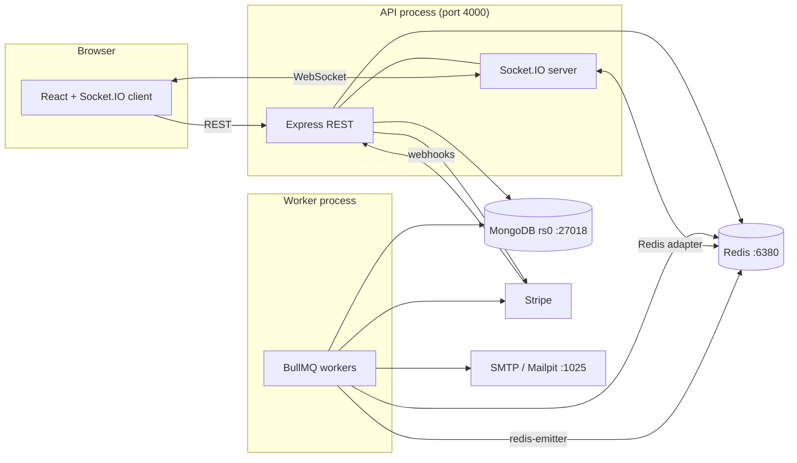

# ARCHITECTURE.md

## 1. Processes



Rules: API handles requests and sockets; worker handles time-based and retryable work. Both are stateless; MongoDB and Redis hold all state.

## 2. Core flows

### 2.1 Place bid
1. `POST /api/auctions/:id/bid` → auth, Zod, rate limit.
2. Idempotency lookup by `(bidderId, idempotencyKey)`; replay returns the stored result.
3. Transaction: conditional pipeline update on the auction (price, status, DB clock, seller, increment) → insert `bids` row → insert outbid `notifications` row.
4. After commit: Socket.IO emit `bid-updated` to `auction:<id>`, `outbid-notification` to `user:<prevId>`, `auction-extended` if extended; enqueue email + fraud evaluation.
5. Respond `201` with the authoritative auction snapshot.

### 2.2 Close auction
1. Delayed job `close_<id>` fires (or reconciler finds an expired auction).
2. Worker loads auction; if `endsAt > DB now` (extended) → re-delay and exit.
3. Transaction: version-guarded update to `payment_pending` / `unsold`; create `payments` row; write outbox events (`auction.closed`, `auction.won`).
4. Outbox dispatcher: emit `auction-ended`, create notifications, send email, enqueue auto-charge or payment-expiry jobs.

### 2.3 Pay
1. Winner clicks Pay → `POST /api/payments/checkout/:auctionId` → Stripe Checkout Session (idempotency key).
2. Stripe webhook → signature check → insert `stripe_events` (unique) → transition payment/auction → outbox `payment.succeeded`.
3. Socket `payment-success` + email to both parties.

### 2.4 Auto-charge (optional path)
Close → if buyer has saved payment method + consent → `autocharge` job → off-session PaymentIntent → success arrives by webhook; failure/`requires_action` → fallback notification with checkout link.

## 3. Time

- Authoritative clock: MongoDB `$$NOW` in all validity checks.
- Client countdown = `endsAt − (Date.now() + serverOffset)`; offset computed from `serverTime` returned by REST responses and a `time-sync` ack on socket connect.

## 4. Failure modes

| Failure | Effect | Mitigation |
|---|---|---|
| API crashes during bid | Transaction aborted or committed atomically | Client retries with same idempotency key |
| Worker down at `endsAt` | Auction stays active briefly | Bids are still rejected by DB clock; reconciler/restart closes it |
| Redis down | No sockets across instances, no jobs | Bids still work via REST; jobs resume, reconciler catches up |
| Job fires twice | Second run no-ops | Version-guarded transition |
| Stripe webhook duplicated/out of order | No double processing | `stripe_events` unique + state-machine guards |
| Commit succeeds, emit fails | Clients stale | Reconnect/visibility refetch; notifications are persisted |
| Clock skew between machines | Wrong validity | DB clock only |

## 5. Module boundaries

`auth`, `users`, `auctions`, `bids`, `payments`, `notifications`, `watchlist`, `reviews`, `analytics`, `fraud`, `admin`, `uploads`. Modules call each other only through service functions, never through another module's model. Cross-cutting: `realtime/`, `queues/`, `lib/`, `middleware/`.

## 6. Dependencies (approved list)

Server: `express`, `mongoose`, `zod`, `jsonwebtoken`, `bcrypt`, `helmet`, `cors`, `cookie-parser`, `express-rate-limit` + `rate-limit-redis`, `socket.io`, `@socket.io/redis-adapter`, `@socket.io/redis-emitter`, `ioredis`, `bullmq`, `stripe`, `nodemailer`, `multer`, `sharp`, `pino`, `pino-http`, `cloudinary`, `tsx`, `vitest`, `supertest`, `socket.io-client` (tests).
Client: `react`, `react-dom`, `react-router`, `@tanstack/react-query`, `socket.io-client`, `zustand`, `tailwindcss`, `react-hook-form`, `zod`, `@hookform/resolvers`, `recharts`, `clsx`, `date-fns`, `lucide-react`, `playwright` (dev).
Check current versions with `npm view <pkg> version` at install time.

## 7. Repository layout

```
nilami/
  package.json            # workspaces: server, client
  scripts/                # infra-up.sh infra-down.sh
  server/src/
    index.ts worker.ts app.ts
    config/ env.ts db.ts redis.ts logger.ts stripe.ts mailer.ts
    modules/<name>/ routes controller service schema model
    realtime/ socket.ts emitter.ts rooms.ts events.ts
    queues/ queues.ts auction.worker.ts maintenance.worker.ts payments.worker.ts notifications.worker.ts fraud.worker.ts
    middleware/ auth.ts validate.ts error.ts rateLimit.ts
    lib/ money.ts errors.ts storage/ idempotency.ts
  server/tests/ unit/ integration/ concurrency/
  client/src/ api/ components/ features/ hooks/ pages/ lib/ store/
```
